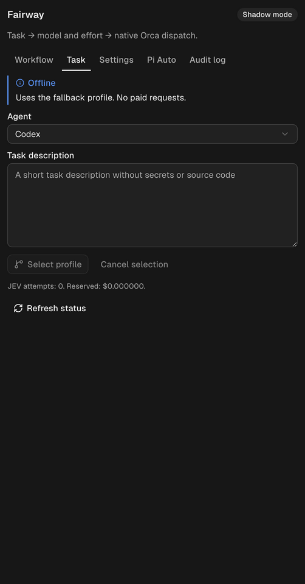

# Fairway for Orca

Плагин Orca, который подбирает разрешённый профиль **агент + модель + усилие** через JEV и позволяет явно запустить задачу штатным способом Orca. Поддержаны адаптеры Codex, Pi и Cursor Agent. Изменять исходный код Orca не требуется.

**По умолчанию: без сети и в режиме наблюдения.** Подбор профиля сам по себе никогда не запускает исполнителя. Примерные профили не доказывают доступность моделей на вашем компьютере.



## Установка

Требуется Orca **1.4.265+**. Для разработки — Node.js **22+**. Сам плагин не имеет сторонних зависимостей исполнения и не требует сборки: Orca загружает TypeScript непосредственно.

Установите выпуск напрямую из GitHub через CLI Orca:

```sh
orca plugin install spscream/orca-fairway@v0.2.0 --json
```

Первая команда покажет состав доступа и завершится с `approval_required`. Проверьте его и выполните выданную Orca команду с точным `--approve` отпечатком. Установка не выполняет `npm install` и не включает платные запросы. На Linux вне терминала Orca используйте `orca-ide`, а не системный экранный диктор `orca`. Добавление стороннего каталога не требуется.

Перед включением Orca покажет доступ плагина: свой фоновой процесс, собственные хранилища данных и секретов, собственные настройки Orca, метаданные рабочих пространств и запуск агентов. Доверенный процесс работает с правами вашего пользователя и вызывает CLI Orca. Это не песочница для недоверенного кода.

## Первый запуск

1. Откройте локальное рабочее пространство и панель **Fairway**.
2. Введите короткую постановку без секретов и исходного кода.
3. Нажмите **Подобрать профиль**. В исходных настройках выбирается резервный профиль без сети.
4. Проверьте модель, усилие и источник подтверждения. Неподтверждённую пару запустить нельзя.
5. Если нужен JEV, сохраните его ключ в поле **Ключ OpenRouter** на вкладке настроек и включите «Разрешить платные запросы JEV».
6. Для явного запуска включите «Разрешить явный запуск через Orca», сохраните настройки, подберите профиль заново и нажмите **Запустить через Orca**.

В JEV отправляются только введённое описание и настроенные карточки профилей. Файлы проекта, предыдущие сообщения, инструменты и вложения автоматически не собираются. Полная постановка в этой версии совпадает с введённым описанием и передаётся выбранному агенту после явного запуска.

`live` разрешает платное решение, `execution` — отдельную кнопку запуска. Ни один из этих параметров не включает автоматический запуск при подборе. Обычные чаты Orca и глобальные настройки агентов не меняются.

## Настройки в интерфейсе Orca

Основные параметры доступны в **Settings → Plugins → Fairway**: платный подбор JEV, разрешение явного запуска, общий бюджет в USD и лимит попыток. В штатных настройках изменения применяются сразу. Существующие параметры версии 0.1.0 переносятся при первом запуске, учёт расходов сохраняется.

На вкладке **Настройки** панели Fairway те же параметры доступны вместе с редактором профилей. Изменения этой формы применяются кнопкой **Сохранить настройки**; редактировать JSON не нужно.

1. Выберите профиль или нажмите **Добавить профиль**.
2. Задайте уникальный идентификатор, агента и точную модель.
3. Для Codex/Pi выберите усилие. Для Cursor оно входит в нативный идентификатор модели.
4. Опишите, для каких задач выбирать профиль.
5. Для Pi отдельно подтвердите проверенную пару. Изменение модели или усилия сбрасывает подтверждение.
6. Выберите резервный профиль и сохраните настройки. При удалении резервного автоматически выбирается первый оставшийся профиль.


Ключ OpenRouter вводится отдельным скрытым полем и сохраняется отдельной кнопкой в защищённое хранилище. В обычные настройки Orca он не записывается. Сохранение формы с несохранёнными изменениями заменяет штатные значения показанными в ней; для загрузки актуальных значений без сохранения черновика нажмите **Отменить изменения**.

Предустановленные профили — примеры, а не подтверждение поддержки модели. Для разных классов задач добавьте несколько профилей с разными описаниями. Максимум — 24. Неизвестные поля, повторные идентификаторы, дубликаты ключей JSON, недопустимые типы и усилие `ultra` отклоняются.

JEV выбирает **идентификатор профиля**, а параметры запуска берутся только из настроек. Порог уверенности 0.6 — предварительная политика, а не измеренная вероятность успеха. При ошибке, низкой уверенности или отсутствии ключа выбирается `fallback`, если он относится к выбранному агенту; иначе первый профиль этого агента. Если профилей агента нет, операция останавливается.

Сохранение настроек отменяет незавершённые запросы и делает старые решения непригодными для запуска. Изменение задачи, рабочего пространства или истечение десяти минут также требует нового подбора.

## Проверка адаптеров

| Агент | Параметры | Проверка перед запуском |
| --- | --- | --- |
| Codex | `--model`, `--effort` через Orca | Точная пара в несекретном `models_cache.json`, возраст не более 7 суток и совпадение версии кеша с `codex --version` |
| Pi | `provider/model`, усилие Orca переводит в `--thinking` | Явное утверждение владельца `operatorConfirmed: true`; расширение Auto дополнительно проверяет наличие модели в реестре Pi |
| Cursor | Точный нативный идентификатор модели, `effort: null` | Наличие идентификатора в `cursor-agent --list-models`; усилие, если оно есть, уже зашито в идентификатор |

Для Cursor используйте `agent: "cursor"`, точный идентификатор из его списка, `effort: null`. `auto` исключён, поскольку не фиксирует конкретную модель. Для Pi используйте `agent: "pi"`, `model: "provider/model"` и одно из `off`, `minimal`, `low`, `medium`, `high`, `xhigh`, `max` после собственной проверки пары. Для Codex и Cursor `operatorConfirmed` не обходит проверку каталога.

Несовпадение версии кеша Codex блокирует запуск. Откройте список моделей нужной версии Codex обычным способом, обновите его метаданные и повторите подбор. Плагин сам не запускает чат для обновления кеша и не читает файлы авторизации. Каталог не гарантирует наличие квоты или право аккаунта на модель; возможный отказ обрабатывает штатный агент.

Успешный ответ CLI Orca означает **принятый запуск**, а не завершение задачи и не доказательство фактически отвечавшей модели. Поля наблюдаемой модели/усилия остаются неизвестными. Если результат запуска потерян, решение больше не используется: сначала нужно проверить Orca, а не запускать задачу ещё раз вслепую.

## Pi Auto

Дополнительное расширение регистрирует виртуальную модель `fairway/auto`; оно не проксирует генерацию. Решение запрашивается один раз и закрепляется на ветке сессии. Авторизацию и вызов физической модели выполняет Pi.

Расширение передаёт **только явно заданное краткое описание** через `/fairway-brief`, а не раскрытые `@files`, историю или текущий текст с исходным кодом. Порядок подключения, ограничения и пример: [docs/pi.md](docs/pi.md).

## Бюджет, данные и сеть

Фиксированная модель решения — `typesafe/jev-1.14`, endpoint — `https://openrouter.ai/api/alpha/decisions`. Перед каждым POST проверяются актуальные публичные метаданные цены, нулевая цена выхода и контекст 262144 токена. В запросе заданы `provider.max_price` $0.05/M на вход и $0 на выход, `allow_fallbacks: false`. При неопределённой цене POST не выполняется.

До сети резервируется **13108 микродолларов ($0.013108)** на попытку — округлённая вверх стоимость полного контекста по верхней цене. По умолчанию разрешены 5 попыток и бюджет $0.10. Настройки ограничены $10 и 100 попытками. Резерв не возвращается после ошибки или тайм-аута и не обнуляется при сохранении настроек или перезапуске процесса. Это учёт только решений JEV; исполнение Codex/Pi/Cursor использует собственный способ оплаты агента.

Запрос — не более 16 КиБ, описание — 4096 байт UTF-8, ответ — 64 КиБ, сетевой этап — 8 секунд. Перенаправления запрещены. Автоматических повторов платных запросов нет.

Ключ JEV хранится только в собственном защищённом хранилище Orca. Плагин не читает `.env`, не извлекает токены подписок и не переносит авторизацию между провайдерами. Переменные `OPENROUTER_API_KEY` и `OPENROUTER_TOKEN` не передаются дочерним CLI. Если исполнителю нужен OpenRouter, настройте его собственную авторизацию отдельно.

Журнал содержит последние 200 событий с идентификаторами профилей, моделью, усилием, состоянием, стоимостью и резервом. Вкладка **Журнал** показывает последние 20 событий. Текст задачи, HTTP-тела, вывод процессов и ключи не записываются. Сами настройки и решения сохраняются в собственном хранилище плагина; планы содержат контрольные суммы задачи и рабочего пространства, без исходного текста. Удаление данных плагина также удаляет локальный учёт бюджета — это не лимит всего аккаунта OpenRouter.

## Разработка и проверки

```sh
npm ci --ignore-scripts
npm test
npm run types:orca
npm run typecheck
npm run test:orca
npm run check:orca
npm run validate
```

`npm test` не требует установленной Orca. Проверки используют вымышленные задачи, имитации сети и запуска; тесты Pi используют только собственный временный локальный HTTP-сервис. Исполнители не запускаются, существующие ключи не читаются. Типы и UI-проверки соответствуют локальной Orca.

Команды проверки Orca сначала подготавливают `.orca/plugin` из проверенного публичного состава. Это исключает `node_modules` и локальные материалы из содержимого плагина. Для просмотра при разработке выполните `npm run stage:plugin`, затем `node scripts/orca.mjs plugin dev watch .orca/plugin --check --shot .orca/shots --json`; после правок повторяйте подготовку. Установка из опубликованного Git-репозитория уже получает чистый состав.

Подробнее: [архитектура](docs/architecture.md), [отчёт первого выпуска](REPORT.md), [границы безопасности](SECURITY.md).

## Состояние 0.2.0

Настройки доступны в штатном интерфейсе Orca и в форме панели Fairway. Реализованы панель, строгий выбор, резервирование бюджета, отмена, защита от повторного запуска, адаптеры и расширение Pi. Проверены автономные тесты и сценарии панели Orca. Живые сквозные запуски всех адаптеров и платный запрос из нового плагина ещё не проверены. Экономия и превосходство выбранных моделей не заявляются.

Пока не поддержаны удалённые рабочие пространства, мобильная панель, прозрачный Auto в обычном списке моделей Orca, универсальный HTTP-прокси и автоматическая смена модели после каждого инструмента. Непроверенная поддержка не объявляется работающей.
