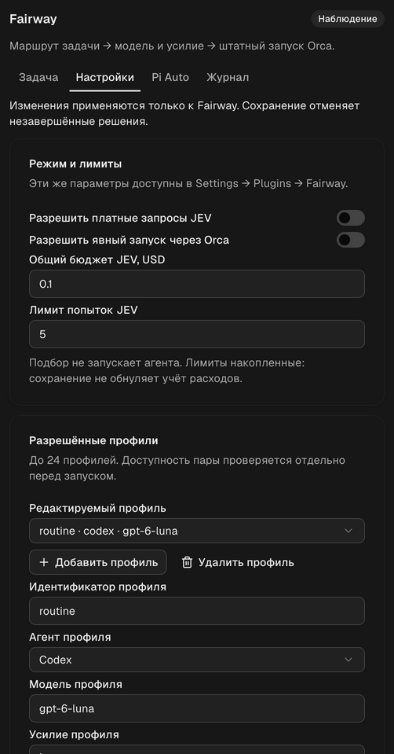

# Fairway for Orca


An Orca plugin that uses JEV to select an allowlisted **agent + model + effort** profile, then explicitly dispatches the task through Orca. Supports Codex, Pi, and Cursor Agent without changing Orca itself.

**Paid JEV requests disabled and shadow mode by default.** Selecting a profile never starts an agent. Example profiles do not prove that a model is available on your machine.


## Install

Requires **Orca 1.4.265+**. Development requires **Node.js 22+**. There are no runtime dependencies or build steps: Orca loads TypeScript directly.

```sh
orca plugin install spscream/orca-fairway@v0.9.1 --json
```

The first command reports `approval_required` and lists the requested access. Review it, then run the exact command Orca provides with its `--approve` fingerprint. Installation does not run `npm install` or enable paid requests. On Linux outside an Orca terminal, use `orca-ide` rather than the system screen reader named `orca`. No additional catalog is required.

Access: a trusted Node worker running as your user, own storage and secrets, own Orca settings, workspace metadata, and agent dispatch. The worker invokes the Orca CLI; it is not a sandbox for untrusted code.

## Interface language

The panel follows Orca's UI locale through `env.locale`; there is no separate language setting. All 11 built-in locales in Orca 1.4.265 have complete UI catalogs: English (`en`), German (`de`), Spanish (`es`), French (`fr`), Japanese (`ja`), Korean (`ko`), Portuguese (`pt`), Russian (`ru`), Turkish (`tr`), Simplified Chinese (`zh`), and Traditional Chinese (`zh-Hant`).

Regional tags use their base language; `zh-TW`, `zh-HK`, and `zh-MO` select Traditional Chinese, while explicit `Hans`/`Hant` script tags take precedence. Unknown community language packs fall back to English. User-written tasks, analysis, profile descriptions, model IDs, effort values, and diagnostic codes are never translated or migrated.

Orca's current manifest API accepts only static strings for native Settings labels and command titles; those and the worker status command remain English. All controls and help inside the Fairway panel, including its Settings tab, follow the app locale. Public documentation remains English. Details and extension guidance: [localization](docs/localization.md).

## First task

1. Open a local Orca workspace and the **Fairway** panel.
2. In **Task**, enter a short description without secrets or source code.
3. Click **Select profile**. Defaults select a fallback without network access.
4. Review the model, effort, and verification source. Unverified pairs cannot launch.
5. For JEV decisions, save an **OpenRouter key**, enable **Allow paid JEV requests**, and click **Save settings**.
6. To dispatch, enable **Allow explicit execution through Orca**, save, select a profile again, then click **Launch through Orca**.

Only the entered description and configured profile cards go to JEV. Project files, conversation history, tools, and attachments are not collected automatically. The entered task is passed to the selected agent only after explicit dispatch. `live` permits paid decisions; `execution` permits explicit launches. Neither setting starts automatic execution by itself or changes ordinary Orca chats and global agent settings.

## Analyze first, then select agents

The **Workflow** tab provides: task and references → coordinator → reviewed analysis → **Run plan automatically** → sequential profile selection, execution, and result handling.

With execution enabled, **Run to result** authorizes the coordinator and the sequential plan together. Fairway validates the coordinator's analysis, selects a verified profile for each step, and can add a correction and a verification step based on a bound executor report. Pending dependent steps wait for verification. The mode allows up to two correction cycles within the eight-step limit. Unresolved questions, required human review, or an unsafe dispatch state pause execution.

Coordinator descriptions accept up to **8192 UTF-8 bytes**, with a warning near the limit. The complete local coordinator prompt has a separate 65536-byte bound; direct task descriptions also accept 8192 UTF-8 bytes.

Select a coordinator profile manually, or choose **Let JEV choose** and supply a separate brief. Preparing with JEV may use one paid decision. The full task stays local. After an explicit launch, the coordinator reads documentation, asks questions in its Orca chat and writes structured analysis to a private Fairway directory. JEV selects subtask profiles after approval using their displayed routing briefs.

Preparation never starts agents. A prepared workflow executor prompt, including dependency-report references and its completion contract, may use up to 65536 UTF-8 bytes locally. JEV receives only the separately bounded routing brief; direct task descriptions accept up to 8192 UTF-8 bytes. After reviewing the analysis, **Run plan automatically** approves that exact graph and authorizes its remaining steps in the same workspace. Fairway selects each profile, verifies it, launches one executor at a time, and accepts a bound result report only after Orca confirms the turn ended and every step-acceptance check passed. Version 2 reports separate step completion from product findings (`findings`, P0–P3): a completed audit can report defects while subsequent review/reporting steps continue. Failed acceptance checks and unresolved questions still pause. Findings remain available to dependent executors in the original report; audit completion does not imply product readiness. This is automatic acceptance of executor evidence, not independent review. Below confidence 0.6, the validated leading JEV choice is retained when both profiles have explicit levels and the leader is at least the fallback level (`routine < standard < deep`). Otherwise the exact configured fallback is used. Both paths require an allowed agent and a verified model/effort pair, without a paid retry. An excluded or unverified fallback pauses the graph. Questions, failed checks, invalid reports, routing errors, exhausted JEV budget and uncertain dispatch pause the graph. Manual controls remain available.

Authorization is bounded to the graph (at most 8 launches), a 30-minute wait per step and a 2-hour window. These bounds stop new actions; a running agent must be stopped in Orca. Executor billing is separate from the JEV cap. Settings/key changes and worker restarts pause execution; loading or updating the plugin never resumes it automatically. A step already launched manually needs one manual review before subsequent steps can be automated. See [automatic execution](docs/automatic.md).

See [workflow instructions](docs/workflows.md) and the [roadmap](docs/roadmap.md).

## Settings and profiles

**Settings → Plugins → Fairway** exposes JEV requests, explicit execution, optional total budget/attempt caps, and **Unlimited JEV decisions**. Native settings apply immediately. Version 0.1.0 settings migrate once without resetting accounting.

The panel's **Settings** tab contains the same preferences and a profile editor. Changes in this form apply with **Save settings**; no JSON editing is required.

1. Select a profile or click **Add profile**.
2. Enter a unique ID, agent, and exact model ID.
3. Select an effort for Codex/Pi. Cursor effort is encoded in its native model ID.
4. Describe when JEV should choose the profile.
5. For Pi, confirm the pair after checking it yourself. Changing its model or effort clears confirmation.
6. Choose a **Fallback profile** and save. Deleting the fallback selects the first remaining profile.



The masked key field saves separately to Orca secret storage, never ordinary settings. Saving a dirty form replaces native settings with the displayed values. **Discard changes** reloads current values.

**Codex 6.2:** New installations use `gpt-6.2-sol · medium` for `standard` and `gpt-6.2-astra · high` for `deep`. In existing installations, choose **Update standard and deep to Codex 6.2** and **Save settings** to replace the matching legacy pairs. Custom pairs can be edited individually.

In Settings, assign each profile a **Profile level** or leave it **Unranked**. Legacy profiles remain unranked; levels are never inferred from model names. Save explicitly. Levels apply only below confidence 0.6 and do not claim measured model quality.

Up to 24 profiles are allowed. Defaults are unverified examples. Unknown fields, duplicate IDs or JSON keys, invalid types, and effort `ultra` are rejected. JEV returns a profile ID; launch parameters come exclusively from configuration. Confidence threshold 0.6 is an initial policy, not a measured success probability. Errors, low confidence, or a missing key use the configured fallback when eligible, otherwise the first eligible profile. No eligible profiles means refusal.

Saving settings cancels pending decisions. Changed tasks, effective configuration, workspace, or a ten-minute expiry require selecting a profile again.

## Adapter verification

| Agent | Parameters | Pre-dispatch verification |
| --- | --- | --- |
| Codex | Orca `--model` and `--effort` | Exact pair in `codex debug models --bundled` from the available binary; older-client fallback: selected Orca account’s non-secret cache, no older than 7 days and matching `codex --version` |
| Pi | `provider/model`; Orca maps effort to `--thinking` | Explicit `operatorConfirmed: true`; the Auto extension also checks the Pi model registry |
| Cursor | Exact native alias, `effort: null` | Exact alias from `cursor-agent --list-models`; effort, if any, is part of that alias |

Cursor `auto` is excluded because it does not fix a concrete model. Pi efforts: `off`, `minimal`, `low`, `medium`, `high`, `xhigh`, `max`, after checking the pair. Manual confirmation cannot bypass Codex or Cursor catalogs.

Fairway prefers the catalog embedded in the available Codex binary: `codex debug models --bundled`. This metadata-only command skips network refresh and starts no agent. Its output stays private and is bounded to 2 MiB with a 10-second timeout; only model IDs, visibility and efforts are used. A successful response missing the exact pair blocks dispatch, as does malformed output. Only command failure permits the legacy cache fallback, whose version and freshness checks remain mandatory. Fairway never rewrites the shared cache or reads authentication files. A catalog entry does not prove account entitlement or quota.

An accepted Orca dispatch does not prove task completion or the model that actually responded. Observed model/effort fields remain unknown. A lost dispatch response consumes the decision: inspect Orca before any new launch.

## OpenRouter balance

The compact OpenRouter balance button opens **Statistics**, where account funds, the key’s remaining limit and Fairway’s JEV usage are shown separately. An unavailable account balance appears as a dash in the compact display. Click **Refresh balance** to make an explicit read-only query, even with paid JEV decisions disabled. With a key saved, an open Fairway panel requests an initial balance after five seconds if no value is cached, and checks every five minutes. The last result stays in memory for the worker lifetime. Transient failures retain the previous known amounts and show a warning in Statistics. Refreshes within 30 seconds reuse the latest attempt, and concurrent refreshes share the same requests. Replacing or deleting the key cancels pending balance requests and clears the cached result.

The [credits endpoint](https://openrouter.ai/docs/api/api-reference/credits/get-remaining-credits) requires a management key. With a normal generation key, the account row may show **Management key required** while the [current-key endpoint](https://openrouter.ai/docs/api/api-reference/api-keys/get-current-api-key) provides its remaining limit. **No key limit** is not an unlimited account balance. Fairway does not request an extra management credential; do not replace your generation credential just to populate this display.

Reads use only the existing own OpenRouter secret, fixed GET endpoints, no redirects, an 8-second deadline, and a 16 KiB response limit. OpenRouter traffic uses a dedicated IPv4 HTTPS connection with normal TLS certificate verification. This avoids Node.js timeouts on hosts with broken IPv6 routing; it does not change system DNS or networking settings. There are no automatic retries. IPv6-only hosts and proxy-only networks need a future transport option. No model is invoked, no balance is added to audit or persistent storage, and JEV accounting remains unchanged. An unavailable or unauthorized result never becomes fabricated zero funds. The displayed balance is informational and does not replace the local JEV reservation limit.

## Pi Auto

The optional extension registers `fairway/auto`. It routes once and pins the physical pair to the session branch; Pi retains authentication and generation. It sends only an explicit `/fairway-brief`, never expanded `@files`, history, or source from the current message. See [Pi setup](docs/pi.md).

## Budget, network, and data

Decision model: `typesafe/jev-1.14`; endpoint: `https://openrouter.ai/api/alpha/decisions`. Before each POST, public metadata must confirm bounded input pricing, free output, and context length 262144. Requests specify `provider.max_price` of $0.05/M input and $0 output, with `allow_fallbacks: false`. Unknown pricing prevents the POST.

Even in unlimited mode, each attempt permanently records a conservative reservation of **13108 microdollars ($0.013108)** before network access: the rounded-up cost of the full context at the price ceiling. Defaults: 5 attempts and $0.10. **Unlimited JEV decisions** explicitly disables both cumulative caps while retaining accounting. In this mode charges can exhaust the OpenRouter balance or key limit. Optional finite caps accept nonnegative safe integer counts and microdollar amounts; there is no fixed $10/100 ceiling. Errors and timeouts do not refund reservations; saving or restarting does not reset them. Automatic authorization checks that a finite allowance can cover the remaining unsubmitted steps before starting, and reports the exact stop cause. In-flight work can still finish without a new decision. This accounts for JEV decisions only. Coordinator and executor costs belong to their agents.

Limits: 16 KiB request, 8192-byte UTF-8 task, 64 KiB response, 8-second network stage. Redirects and automatic paid retries are disabled.

The JEV key stays in own Orca secret storage. Fairway does not read `.env` files, extract subscription credentials, or move authentication across providers. Child CLIs do not inherit `OPENROUTER_API_KEY` or `OPENROUTER_TOKEN`; configure their own authentication separately if needed.

Audit storage keeps 200 metadata events; **Audit log** displays the latest 20. No task text, HTTP bodies, process output, or keys are logged. Routing plans store task/workspace hashes rather than task text. Workflow data separately contains the original task, analysis, instructions, and accepted summaries, stored locally. New plans put analysis and executor reports under `.orca/fairway-workflows/` in the selected workspace, with a local Git ignore file. Older plans retain their original files and paths. Reports remain on disk after closing a plan. Removing plugin data removes local accounting, not the account-wide OpenRouter limit.

## Development

```sh
npm ci --ignore-scripts
npm test
npm run types:orca
npm run typecheck
npm run typecheck:core
npm run test:orca
npm run check:orca
npm run validate
npm run audit:public
```

`npm test` works without Orca. Tests use synthetic tasks, mocked network/dispatch, and temporary local HTTP/filesystem fixtures. No real agents start and no existing credentials are read. Types and UI checks match the installed Orca.

Orca checks stage the audited public surface in `.orca/plugin`, excluding `node_modules` and private research. For visual development, run `npm run stage:plugin`, then `node scripts/orca.mjs plugin dev watch .orca/plugin --check --shot .orca/shots --json`; restage after edits. Git installation receives the clean public files directly.

See [architecture](docs/architecture.md), [verification report](REPORT.md), and [security boundaries](SECURITY.md).

## Release status

0.4.3 uses an original open-frame buoy with a broad float and turquoise waves in the plugin listing and panel header. Orca currently limits the sidebar activity button to built-in symbols, so the activity button uses the built-in flag symbol. The 256×256 PNG is bundled locally; permissions and behavior are unchanged.

0.6.0 adds opt-in sequential execution with one graph authorization, per-step JEV selection, native completion monitoring, bound result reports, pause controls, and preserved manual workflows. Offline synthetic tests and Orca scenarios pass. No real automatic executor run or paid routing call was used to validate this release; independent result review, isolated worktrees and interception of agent-internal subagents remain unimplemented.

Remote workspaces, mobile UI, transparent Auto in the native Orca model list, a universal generation proxy, and per-tool model switching are not supported.
