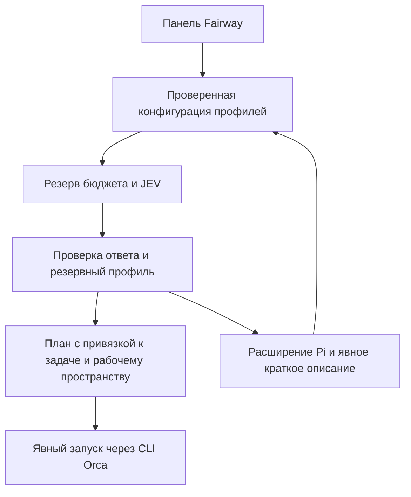

# Архитектура Fairway

Fairway — отдельный плагин Orca: панель компонентов, доверенный фоновый процесс и общая логика на TypeScript без зависимостей исполнения. Исходный код Orca не меняется.

`src/core/config.ts` проверяет настройки и пары; `jev.ts` ограничивает endpoint, цену, размер и ответ; `engine.ts` сериализует изменения журнала и бюджета, сохраняет намерение запуска до процесса и блокирует повтор. `runtime.ts` проверяет каталоги и формирует безопасный массив аргументов. `bridge.ts` предоставляет дополнительный локальный интерфейс только для решений Pi.

`src/worker.ts` связывает общую логику с собственным хранилищем и секретами Orca. Он проверяет локальный хост рабочего пространства, не открывает файлы проекта и не отправляет задачу при активации. `src/panel.tsx` — пользовательский интерфейс, который запускает подбор отдельно от исполнения. `adapters/pi.ts` использует виртуальную модель Pi и не требует перехвата всех запросов генерации.

Плагин использует CLI Orca для запуска, поскольку в проверенном Host API 1.10 метод `agent.launch` не имеет полей модели и усилия и запускает терминальную сессию. У CLI есть документированные параметры выбора. Способ Chat/CLI остаётся за настройкой Orca; отказ или потерянный ответ не вызывают нового запуска.

Обработчик `agent.launch.before` не используется: он не получает текст задачи и имеет короткое время ответа. Сетевой вызов JEV не должен задерживать все обычные запуски Orca. Плагин не заявляет перехват стандартной первой отправки родного чата.

В первой версии физические пары подтверждаются до исполнения, но квоты и право аккаунта на модель не выводятся из наличия CLI. Настроенное, переданное и фактически наблюдаемое значения не смешиваются: успешный ответ Orca означает принятие, поля наблюдения остаются неизвестными.

Смена конфигурации и отмена завершают активные запросы. Планы действуют десять минут и связаны с контрольными суммами описания, конфигурации и пространства. Статус `dispatch_pending` сохраняется до вызова CLI; после ошибки или тайм-аута решение нельзя использовать повторно. Старые планы остаются в собственном хранилище как метаданные, но больше не исполняются. Журнал ограничен 200 событиями.

Все режимы используют одну логику бюджета. Резервирование консервативное и сохраняется даже при ошибке. Это локальный лимит решений JEV, не управление оплатой исполняющих провайдеров и не общий лимит аккаунта.

Первичные интерфейсы:

- [Orca plugin host API](https://github.com/stablyai/orca/blob/main/docs/reference/plugin-host-api.md).
- [Pi virtual models](https://github.com/earendil-works/pi/blob/main/packages/coding-agent/docs/virtual-models.md).
- [JEV Decisions API](https://openrouter.ai/docs/guides/community/jev).
- [Фиксированная модель typesafe/jev-1.14](https://openrouter.ai/typesafe/jev-1.14).
- [Cursor CLI](https://cursor.com/docs/cli/reference/parameters).

Полноценный Responses-шлюз Codex, сбор метрик фактически ответившей модели, удалённые хосты и мобильный интерфейс остаются отдельными направлениями. HTTP-прокси Cursor не объявляется поддержанным на основании одного флага `--endpoint`.
