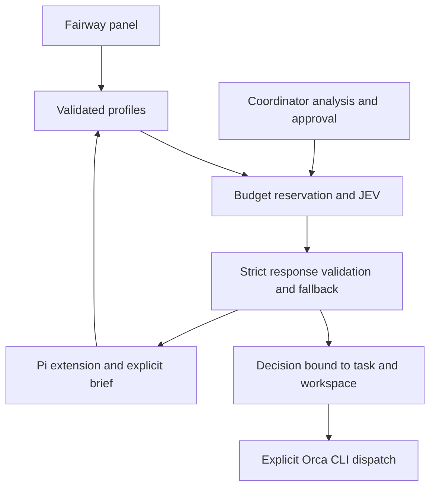

# Fairway architecture

Fairway is a standalone Orca plugin: a components panel, a trusted Node worker, and shared TypeScript logic with no runtime dependencies. Orca source is unchanged.

`src/core/config.ts` validates configuration and pairs. `jev.ts` bounds endpoint, pricing, payloads, and responses. `engine.ts` serializes budget/audit writes, persists dispatch intent before process creation, and prevents duplicate dispatch. `runtime.ts` verifies catalogs and builds argument arrays without a shell. `bridge.ts` provides the optional decision-only Pi service.

Modes and limits are declared through `contributes.settings` and stored in `orca.settings`; profiles and fallback live in own storage. Configuration reads combine both before each operation, so disabling execution in native settings also blocks a pending launch. Legacy 0.1.0 settings migrate once without resetting the ledger.

`src/worker.ts` connects the core to own Orca storage and secrets. It checks local workspace metadata, does not read project files, and never sends a task on activation. `src/panel.tsx` separates selection from dispatch. `adapters/pi.ts` registers a virtual model without proxying generation.

`workflow.ts` validates coordinator analysis and dependencies, fixes approved content, selects profiles using routing briefs, and gates dependent work on reviewed results. `artifacts.ts` reads bounded analysis files only from pre-created private directories. Original task, local instructions, and short accepted reviews stay in workflow storage; they are excluded from audit and automatic JEV input.

The verified Host API 1.10 `agent.launch` method lacks model/effort fields and launches terminal sessions. The native Orca CLI provides documented selection parameters for either surface. Chat/CLI preference remains Orca's choice; refusal or a lost response does not cause a fresh launch.

The `agent.launch.before` hook is not used: it lacks task text and has a short deadline. JEV calls should not delay unrelated launches. Interception of the first native chat message is not claimed.

Verification distinguishes configured, dispatched, and observed values. A catalog does not prove account quota or entitlement. An accepted dispatch does not establish the responding model; observed fields remain unknown.

Routing decisions expire after ten minutes and bind task, configuration, and workspace hashes. Configuration changes and cancellation abort pending requests. `dispatch_pending` is persisted before the CLI call. Uncertain execution is never blindly retried. Expired plan metadata remains in own storage; audit is bounded to 200 events.

All routes share conservative persistent JEV accounting, including failures. This is a local decision budget, not an account-wide OpenRouter limit or execution-provider budget.

Primary interfaces:

- [Orca plugin host API](https://github.com/stablyai/orca/blob/main/docs/reference/plugin-host-api.md)
- [Pi virtual models](https://github.com/earendil-works/pi/blob/main/packages/coding-agent/docs/virtual-models.md)
- [JEV Decisions API](https://openrouter.ai/docs/guides/community/jev)
- [Fixed typesafe/jev-1.14 model](https://openrouter.ai/typesafe/jev-1.14)
- [Cursor CLI](https://cursor.com/docs/cli/reference/parameters)

A full Codex Responses gateway, actual-response model telemetry, remote hosts, and mobile UI remain separate work. A Cursor generation proxy is not claimed from the existence of an `--endpoint` flag.
