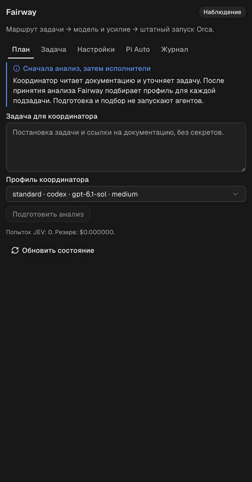

# Координатор и подзадачи

Этот режим предназначен для неточной постановки или задачи со ссылками, когда профиль исполнителя имеет смысл выбирать после анализа.

1. В локальном пространстве Orca откройте вкладку **План**. Введите постановку со ссылками, до 2000 байт UTF-8.
2. Выберите профиль координатора и нажмите **Подготовить анализ**. Проверяется точная разрешённая пара. JEV не вызывается, агент не запускается.
3. Включите явное исполнение в настройках, если оно выключено. При изменении конфигурации подготовьте новый план координатора: закройте старый план и повторите подготовку.
4. Нажмите **Запустить координатора через Orca**. В его чате ответьте на уточняющие вопросы. Координатору поручено прочитать источники, подготовить анализ и записать `analysis.json` по показанному приватному пути.
5. Нажмите **Прочитать анализ координатора**. Проверьте выводы, допущения, источники, инструкции, критерии результата и отдельные описания для JEV. Чтение источников заявляется координатором, технически плагином не доказывается.
6. Если есть вопросы или недоступные источники, продолжите разговор с координатором и попросите обновить файл. Без их разрешения принятие заблокировано. Все HTTP(S)-ссылки из постановки должны быть перечислены в источниках.
7. Нажмите **Принять анализ и план**. После этого содержание неизменно; для пересмотра нужен новый план. Максимум — 8 шагов с уникальными идентификаторами и зависимостями без циклов.
8. У готового шага нажмите **Подобрать исполнителя**. Выбор идёт среди разрешённых профилей всех допустимых для шага агентов: Codex, Pi, Cursor. В JEV передаётся только `routingBrief`, до 800 байт, вместе с карточками профилей. При выключенном JEV используется допустимый резервный профиль.
9. Проверьте выбранную пару и нажмите **Запустить подзадачу**. В инструкции исполнителю передаются локальный контекст, критерии и принятые краткие результаты зависимостей. Не более одного неподтверждённого запуска в одном плане.
10. После проверки работы в Orca введите краткое подтверждение до 160 байт UTF-8 и нажмите **Подтвердить результат**. Это утверждение владельца после проверки, а не автоматический анализ качества. Зависимые шаги становятся доступны.

Подбор не является разрешением запуска. Состояние `submitted` означает принятие Orca, а не завершение задачи. При потерянном ответе запуск получает `dispatch_unknown`; повтор и зависимые действия блокируются. Проверьте Orca. Закрытие плана не останавливает работающего агента и не доказывает, что он завершился.

Профиль координатора выбран явно, потому что содержание задачи ещё не проанализировано. Оплата координатора и исполнителей относится к выбранным агентам. Бюджет Fairway ограничивает только решения JEV, общий для обычного подбора и всех планов.

## Хранение и ограничения

В собственном хранилище Orca сохраняются постановка, принятый анализ, инструкции, состояния и краткие результаты. Это локальные рабочие данные. В аудите остаются только идентификаторы, состояния и сведения о подборе. Файлы анализа создаются в отдельных папках `~/.config/fairway-for-orca/workflows/<id>/`; на Unix папки имеют права 0700. Они не входят в Git и не удаляются автоматически при закрытии плана.

Плагин читает только `analysis.json` из заранее созданной собственной папки. Ограничение — 32768 байт, дубликаты ключей, лишние поля и символические ссылки отклоняются. Пути из ответа координатора не исполняются и не используются для чтения файлов. На Windows права нужно контролировать ACL средствами ОС.

Исходный текст документов не загружается плагином и не передаётся JEV. Координатор использует собственные инструменты и разрешения Orca. Просьба не запускать собственных субагентов задана в его инструкции; это не ограничение ОС. Плагин управляет только запусками, которые проходят через Fairway. Внутренние субагенты и другие уже работающие агенты не перехватываются.

Шаги одного плана исполняются последовательно в выбранной папке. Изолированные рабочие копии, глобальная блокировка папки, автоматический приём результатов, автоматический пересмотр плана и восстановление неопределённого запуска в эту версию не входят. Если эффективная конфигурация или срок действия решения изменились, выполните подбор шага заново перед запуском.

Формат анализа задан в инструкции координатору (`coordinatorPrompt` в `src/core/workflow.ts`). Поля `instructions`, `context`, `acceptance` предназначены исполнителю; `routingBrief` — отдельно просматриваемое описание для JEV. Поля выбора модели в анализе запрещены: параметры запуска всегда берутся из разрешённого профиля.
